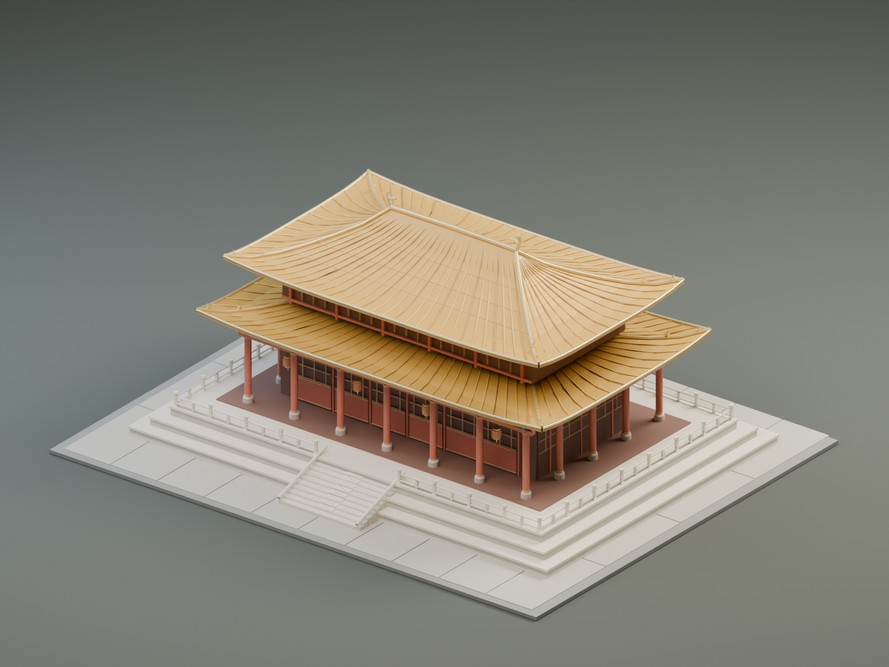

# 维珀 Voxamber · 把你的 AI 创意带进三维世界

通用 3D 建模生产力 App。用户在自己的 ChatGPT、Gemini、Grok、Claude、Qwen、GLM、Kimi、DeepSeek 等 AI 应用中创作 Three-Live 场景代码，再由 iPhone 本机生成、预览、保存并分享模型。创作题材由用户决定，示例不构成类别白名单。

- 粘贴代码、导入文件；系统分享扩展接收代码文本／文件，用户在主 App 中确认后生成。
- 真正的 Google Three-Live 官方原生 SDK `v1.2.3`，固定提交 `c0ff24b628795286a175f1a71611673df5dbc05d`。源程序只执行一次生成 GLB，再从同一 GLB 转 USDZ；使用纯 Swift 修复 Apple 所需的材质元数据。
- 保留原始导入内容、实际场景代码和每次不可变修订；SHA 校验、原子保存、并发版本检查。历史 `Documents/Creations` 只读保留，新作品使用独立 `Documents/ScenePrograms`。
- 本机生成不要求先下载语言模型，也不把提示词或场景代码发送到我们的服务器。用户使用其他 AI 服务的过程发生在其自行选择的应用中。
- SwiftUI 原生 Liquid Glass、紧凑导航与大屏 `NavigationSplitView`；RealityKit 预览、真实 Quick Look 缩略图、USDZ／GLB／场景源文件分享与系统 AR 预览。

新目标工程：[Apple/ThreeLiveStudio.xcodeproj](Apple/ThreeLiveStudio.xcodeproj)，选择 **Voxamber-SceneStudio**；独立手机验收选择 **Voxamber-SceneQA**。`ThreeLiveStudio` 和此前图像／混元实验保留为历史源码，不是本次发布目标。用户已明确允许官方 SDK 内置的受限场景引擎；App 不使用 Python、Node 或 WebView 来替代它。

开发版本为 **0.2.0 (7)**，正在完成手机、签名和 TestFlight 验收；最近已核验可供本人内部测试的旧版仍为 **0.1.0 (6)**。编译通过、模拟器、实机、Apple 处理和可下载测试分别记录，未通过的阶段不算完成。

[通用 AI 创作说明](docs/source-authoring-instructions.md) · [官方编译器回归证据](docs/qa/2026-11-06-three-live-native-return) · [本次发布证据](docs/qa/2026-11-06-scene-studio-release)

官网：[维珀](https://gptalgopro.github.io/Voxamber-Website/) · [支持](https://gptalgopro.github.io/Voxamber-Website/support/) · [隐私政策](https://gptalgopro.github.io/Voxamber-Website/privacy/)。

原有 Three-Live Mac 宫殿实验是官方编译的回归基线。场景由 Codex 会话与宿主参数程序创作；它不是端侧小模型自主生成能力的证明。

---

# 琉金重檐殿 · Three-Live Apple 实验

已在 Apple M3 Max / macOS 27.2 上，用 **Google Three-Live v1.2.3 官方原生编译器**从零生成可复现的中国宫殿风格模型。模型含双层曲面庑殿顶、168 条瓦垄、抽象脊兽、20 根柱、斗拱、格扇门、灯笼、三层石台基、栏杆及正面台阶。

这是太和殿风格的原创桌面模型，不是文物测绘复原。当前模型宽 1.008 米、高 0.42216 米、深 0.81936 米，Y 向上，底部为零。



## 查看成品

- [GLB 模型](artifacts/palace.glb)：约 0.86 MiB。
- [Apple 兼容 USDZ 模型](artifacts/palace.usdz)：约 0.61 MiB。
- [完整 iOS / macOS 管线研究](docs/three-live-apple-pipeline.md)：固定版本源码、Swift API、执行限制和导出缺陷。
- [运行及哈希记录](artifacts/validation.json)、[GLB 校验](artifacts/glb-validation.json)、[RealityKit 原生回读](artifacts/realitykit-validation.json)。
- [Mac 原生 Preview 截图](artifacts/macos-preview.png)、[跨格式视觉与浏览器验证](artifacts/visual-verification.json)。

本地浏览器交互预览：运行 `python3 scripts/serve.py`，打开 <http://localhost:8765/>。可旋转、缩放、下载两个格式，以及在 Worker 沙箱中重新编译同一场景源码。

在同一 Wi-Fi 的 iPhone Safari 中，以这台 Mac 的局域网地址替换 `localhost`，点击页面的“Apple AR 预览”。**本轮已完成 Mac 生成、原生读取和实际显示；尚未完成 iPhone 真机 AR 放置验收。**

## 从零重跑

需要 Apple Silicon Mac、Python 3、Node.js、Swift/Xcode，以及 Apple USD Tools 中的 `usdcat`、`usdzip`、`usdchecker`。本机已经具备。初次下载需要联网；安装后几何生成、编译、校验和预览都使用本地资源。

```sh
cd /Users/kaisun/Three-Live
python3 scripts/setup.py
npm ci --ignore-scripts --no-audit --no-fund
python3 scripts/run_pipeline.py
python3 scripts/serve.py
```

`setup.py` 下载固定的官方 arm64 CLI 和 Web bundle，并与 GitHub Release 提供的 SHA-256 digest 核对；校验结果见 `tools/release-receipt.json`。`upstream/` 为固定 tag 的官方参考源码，生成器运行不依赖该 checkout。

实际路径为：**当前 AI 编码会话编写参数生成器 → Python 预计算复杂网格和法线 → 场景 JavaScript → 官方 Rust/Boa 沙箱 → GLB 与原始 USDZ → Apple 元数据修复 / USDC 打包 → 校验 / RealityKit / Preview**。没有下载输入模型、生成模型权重或贴图，也没有使用 Blender 或通用 Three.js 导出器代替 Three-Live 生成。几何预算集中在 17 个按材质合并的网格，共 26,150 顶点、22,040 三角形。

原版 v1.2.3 的 USDZ 缺少 `MaterialBindingAPI` 声明，Apple 严格校验会失败。`run_pipeline.py` 保留 `palace-raw.usdz` 与 `palace-from-glb-raw.usdz`，补齐材质绑定声明、明确 `subdivisionScheme = "none"`，再转成 USDC 后打包为 `palace.usdz`；最终文件通过严格检查。两种官方原始导出路径的字节完全相同。

## 编辑和验证

修改 [generate_palace.py](scripts/generate_palace.py) 中的建筑参数和材质，再执行完整管线。生成器会检查法线、退化面、重复面、面朝向、脚本大小与几何配额。原生脚本仅约 1 MiB，增加细节时必须继续检查限制。

`run_pipeline.py` 同时执行 Khronos glTF Validator 和 Apple 严格检查，并调用 [Swift RealityKit 检查器](scripts/check_realitykit.swift)，比较两个格式的网格数、三角形数和实际米制包围盒。首次需要时自动编译 Swift 检查器。

下面的 Blender 命令只用于独立导入和对照渲染，不参与模型生成：

```sh
/Applications/Blender.app/Contents/MacOS/Blender --factory-startup -b -t 8 --python-exit-code 1 --python scripts/render_models.py -- artifacts/palace.glb artifacts/palace-glb.png
/Applications/Blender.app/Contents/MacOS/Blender --factory-startup -b -t 8 --python-exit-code 1 --python scripts/render_models.py -- artifacts/palace.usdz artifacts/palace-usdz.png
```

输出 PNG、导入统计 JSON 及含相机 / 灯光的 `.blend` 检查文件。两种格式的对照图使用同一相机及灯光，导出模型中不包含这些工作室设施。

上游项目仍为 Developer Preview / Alpha。[官方仓库](https://github.com/google/three-live)、[本次固定版本](https://github.com/google/three-live/releases/tag/v1.2.3)。

## iOS 27.3 跟踪与 2026 年 12 月研发

当前对话继续跟踪 iOS 27.3 正式版及维珀兼容性，沿用任务现有的每日 00:00 调度；首次确认正式版后提醒更新，并评估现有工程，不重建已存在的 Xcode 项目。完整安排见 [发布跟踪计划](docs/tracking/ios-27.3-monitoring-plan.md)，实际里程碑保存在 [跟踪状态](docs/tracking/ios-27.3-watch.json)。[早期 12 月设计](docs/plans/2026-12-iphone-offline-xcode-design.md) 已标为历史，以当前原生通用建模方案为准。

Apple 已公告首批中国区 Apple 智能功能计划随 12 月的 iOS 27.3 推出；第三方 Foundation Models 的中国区资格及具体 iPhone 本地模型可用性仍须独立验证。现有原生 MLX / Metal 研发照常推进；Apple 本地模型作为可选候选评估，12 月跟进阶段复盘。本机跟踪需要 Mac 开机并保持桌面 App 运行。
