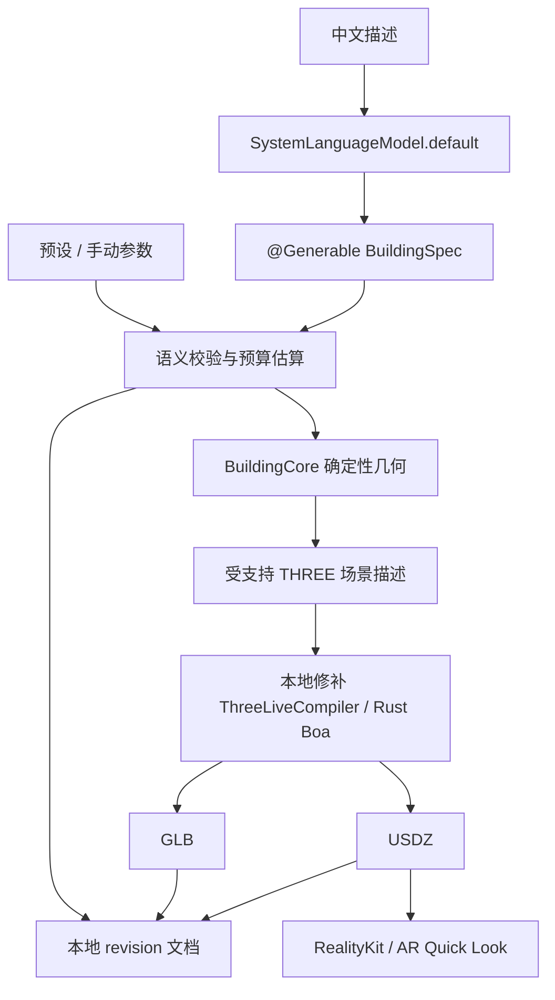

# ThreeLiveStudio：2026 年 12 月 iPhone 离线研发设计

> 历史设计，已被当前 Voxamber 方案替代（2026-11-06 核对）。当前要求见根目录 [AGENTS.md](../../AGENTS.md)、[原生实施记录顶部修正](2026-11-05-native-minicpm-app.md) 与 [结构化造型方案](2026-11-05-native-structured-generation-design.md)。现有工程已建立并在 `dev` 开发；产品是通用建模 App，采用原生 Swift / MLX / Metal，不能恢复本文件中的建筑限定、Boa/JS 编译器或“仅 Apple 模型”的旧决策。下文保留原始设计历史，不作为自动任务实施指令。12 月安排已调整为现有研发的阶段复盘，见 [发布跟踪计划](../tracking/ios-27.3-monitoring-plan.md)。

状态：**待实施的工程设计**。编制日期：2026-11-05；正式研发窗口：2026-12-01 至 2026-12-31。本文仅设计 Xcode 工程与验收路径，本轮不创建工程、不实现 App，也不表示已经构建、安装或提交 App Store。

## 1. 目标与现有依据

首版在 iPhone 完成本地闭环：中文描述 → Apple 系统端侧模型解析参数 → 确定性古建筑几何 → Three-Live 导出 GLB / USDZ → RealityKit 查看与 AR Quick Look → 本地保存和再次编辑。模型尚不可用时，手动参数与建筑预设仍能完成生成、保存和导出。

已验证的起点是当前工作区的 Mac 管线：M3 Max / macOS 27.2 上，官方 Three-Live v1.2.3 编译出 17 个材质网格、26,150 顶点、22,040 三角形的“琉金重檐殿”。GLB 通过 Khronos 校验；USDZ 补充材质绑定和细分声明后，通过 Apple 严格校验、RealityKit 原生读取及 Mac Preview 实际显示。当前 Python 几何生成器和 Apple USD 命令行工具属于 Mac 实验实现，**尚没有 iPhone 端上生成和 AR 验收证据**。依据：[现有 README](../../README.md)、[管线研究](../three-live-apple-pipeline.md)、[实际验证](../../artifacts/validation.json)。

### 系统发布与模型可用分开判断

Apple 2026-10-31 公告确认：中国首批核心 Apple 智能功能计划随 **12 月 iOS 27.3 正式版**推出；其他平台待必要审批。该文**没有明确承诺第三方 Foundation Models API 在中国同步开放**。2026-11-05 检查的开发者发布页仍列出 11 月 3 日的 iOS 27.3 beta，不应将 beta 或公告当成正式发布。[Apple 中国公告](https://www.apple.com.cn/newsroom/2026/10/apple-intelligence-features-are-coming-to-users-in-china/)、[Apple Developer Releases](https://developer.apple.com/news/releases/)。

因此分别记录：正式 OS 已发布、目标手机已更新、机型及地区 / 语言资格、Apple 智能开关、系统模型资源已就绪、`SystemLanguageModel.default.availability` 实际可用，以及断网后中文结构化生成成功。系统发布通知触发检查，不触发自动升级或自动宣告模型可用。macOS 仅规划后续共享几何与编译包，不假定中国区 Mac 的模型开放时间。

## 2. 工程结构与调用路径

未来工程位置为 **`Apple/ThreeLiveStudio.xcodeproj`**，App 名称与主 scheme 为 **`ThreeLiveStudio`**。首个验收运行环境为受支持 iPhone 上的 iOS 27.3 正式版；具体 deployment target、Xcode 与 SDK 版本在 12 月第一周核对后固定。基础几何工作不等待系统模型开放。

```text
Apple/
  ThreeLiveStudio.xcodeproj
  ThreeLiveStudio/
    App/                    # SwiftUI 入口、能力状态、文档列表
    Generation/             # SystemLanguageModel 适配器、@Generable BuildingSpec
    Editor/                 # 中文输入、参数编辑、生成状态
    Preview/                # RealityKit 与 Quick Look 的薄封装
    Storage/                # 本地项目与完整 revision 的原子发布
    Resources/              # 少量建筑预设与材质常量，均随包离线携带
  ThreeLiveStudioTests/      # 模型适配、文档恢复、编译产物检查
  ThreeLiveStudioUITests/    # 真机生成 / 保存 / 导出流程
  Packages/BuildingCore/
    Sources/BuildingCore/    # 参数校验、确定性几何、法线、场景序列化
    Tests/BuildingCoreTests/
  Vendor/ThreeLiveCompiler/  # 固定本地 Swift 包与修补后 XCFramework
patches/three-live/          # 12 月实施时保存补丁、来源提交、构建记录与校验和
```

Xcode 只设一个 iOS App target、一个单元 / 集成测试 target、一个 UI 测试 target。`BuildingCore` 是一个小型本地 Swift Package；ThreeLiveCompiler 是本地依赖，沿用上游 Rust / Boa 和 Swift 包装。不再拆出多个独立业务 framework，也不在首月增设 macOS App、账号服务、远程推理服务或同步后端。



## 3. 关键决策记录

以下 ADR 为本次设计选择，实施需按真实 SDK、区域能力与目标手机复核；用户已授权的离线方向保持不变。

### ADR-001：只用 Apple 系统端侧模型解析结构化参数

**背景：** 手机上的核心任务是提取有限建筑参数，长篇代码生成会增加延迟、错误面和沙箱压力。

**决定：** 仅显式选择 `SystemLanguageModel.default`；使用 `LanguageModelSession` 与 `@Generable BuildingSpec` 生成小型参数对象。核心几何层接收完成独立验证的 `BuildingParameters`，不导入 FoundationModels。模型不输出任意 JavaScript、文件路径、网络地址、逐顶点数组或可执行工具调用。会话只携带当前参数和本次修改意图，避免无限累积聊天历史。

**代价与替代：** 结构化参数限制了首版建筑风格范围，但便于可靠编辑和复现。自由代码生成不纳入首版；PCC、千问、其他云模型或网络代理不作为降级路径。模型不可用时保留预设与参数编辑，不把远程推理伪装为离线。[Apple SystemLanguageModel](https://developer.apple.com/documentation/foundationmodels/systemlanguagemodel)、[guided generation](https://developer.apple.com/documentation/foundationmodels/generating-swift-data-structures-with-guided-generation)。

### ADR-002：先把现有几何生成器移植到 Swift，保留 Rust 编译器

**背景：** 当前 Python 生成器已经产生可校验资产，但 iPhone 不应依赖 Python、Node、Mac 服务或 Mac USD CLI。

**决定：** 用 `BuildingCore` 中的纯 Swift 实现参数检查、屋面曲线、柱网、斗栱、台基、去重和法线；按稳定顺序合并材质网格，使用固定量化规则，输出 Three-Live 支持的场景描述。Rust 继续承担现有 Boa 与格式编译。若真机分析证明 Swift 几何计算是瓶颈，再把明确热点移入已有 Rust FFI；不同时维护两套完整几何算法。

**代价与替代：** Swift 移植需要与现有样本做几何对照，不能只凭视觉相似就宣告完成。将全部几何逻辑重写到 Rust 会增加首月桥接成本；在 Boa 中动态计算全部细节则受原生 250 ms 预算影响。预制模型直接载入可作对照样本，不能代替“从参数生成”的验收。

### ADR-003：修复上游导出器并在构建时生成本地 XCFramework

**背景：** v1.2.3 原始 USDZ 缺少 `MaterialBindingAPI` 和 `subdivisionScheme = "none"`；当前 Mac 后处理无法直接搬到手机。

**决定：** 以 v1.2.3 / `c0ff24b628795286a175f1a71611673df5dbc05d` 为已知基线；12 月开工时重新审阅上游版本，选择后固定提交。若未修复，在 exporter 源码同时补充材质绑定 schema 和普通多边形细分声明，重建 author engine 资产与 Rust Apple XCFramework，再由本地 Swift 包引用。记录原始来源、补丁、工具链、支持 slice、SHA-256 和 Apache 许可，不暗中替换远端 SPM 的校验包。

**代价与替代：** 本地补丁带来升级维护责任，但手机生成的 USDZ 不再需要 Mac 进行格式修补。首版保留 Three-Live 支持的 USDA + 64 字节对齐、无压缩 ZIP 输出；USDC 体积优化不是验收前置条件。`usdcat` / `usdzip` / `usdchecker` 只在开发机验证，手机运行不调用它们。替换为另一套 USD 导出器会扩大范围，暂不采用。

补丁必须覆盖 scene → USDZ 与 GLB → USDZ 两条路径，不能只修本次样本。遵守原生 250 ms 脚本、1000 ms 打包和几何配额，不通过放宽 watchdog 换取成功。[上游实现与限制](../three-live-apple-pipeline.md)。

### ADR-004：小文档、完整 revision 发布，离线数据留在手机

**背景：** 生成可能失败、取消或因 App 终止被打断；参数编辑不应损坏上一个可用模型。

**决定：** 本地 `Application Support/Buildings/<UUID>/` 保存项目，包含版本化参数 JSON、生成器版本、编译器 / 补丁版本、质量档、文件哈希和完整输出 revision。参数是编辑来源，GLB / USDZ 是可再生缓存。单一存储 actor 串行写入；先写临时 revision 并回读校验，再原子发布 manifest / 当前指针；失败保留前一完整 revision，启动时忽略或清理未发布临时目录。使用原子文件写入及适当的 iOS 文件保护，迁移前保留旧版本快照。

**代价与替代：** 独立版本目录暂占额外磁盘，需要明确缓存清理和删除项目行为；比引入数据库管理小量文件关系简单。首版不接 CloudKit、iCloud 自动同步或联网遥测。用户主动用 Files / 分享面板导出后，由用户选择目的地；它不成为生成或保存的网络依赖。

### ADR-005：原生展示与 AR 分别验收

**背景：** 当前已有 Mac 原生加载证据；在 iPhone 上编译成功、模型能打开、相机中放置成功是三个不同结果。

**决定：** App 内用 RealityKit 加载本机 USDZ，编辑 / 旋转 / 缩放在原生视图完成；GLB 用于标准格式导出。AR Quick Look 从持久或明确管理生命周期的本地 URL 打开，声明相机用途；设备不支持 AR 或用户拒绝相机时仍保留模型查看。视图、相机、地面与光照不写进建筑导出资产。模型采用 Y 向上、米制和底部 Y=0，展示缩放与导出的真实尺寸分别记录。

**代价与替代：** Quick Look 只承诺静态模型查看和系统 AR，不承诺自定义 JavaScript / XR 插件继续交互。WebView 方案不是首版原生展示入口；后续 macOS 可共享参数、几何和编译包，再单独建立平台视图。

## 4. BuildingSpec 契约与模型能力状态

首版只支持已实现的宫殿 / 亭式参数组合，避免模型编造不存在的构件。下列为待实现的契约，数值范围需以真机预算回归确定：

| 参数组 | 结构化内容及验证 |
| --- | --- |
| 文档身份 | `schemaVersion`、项目 UUID 由 App 写入，不能由模型决定；名称做长度检查 |
| 建筑形态 | `roofStyle`、1–2 层屋檐、柱网开间及进深、台基层数、台阶数量，用受控枚举和范围 |
| 尺度 | 宽 / 深 / 高用米，拒绝 NaN / infinity / 非正值；检查柱高、檐口、屋脊及台阶间的相对约束 |
| 风格与材质 | 只引用随包材质预设 ID；输入“青瓦、朱柱”等映射到已实现参数 |
| 细节与复现 | `qualityTier` 与确定性 seed；复杂度由几何层估算和裁剪建议决定，不信任模型自行声称的预算 |
| 修改请求 | 基于当前有效参数生成新草稿；经校验后作为新 revision，不直接覆盖已保存项目 |

`@Guide` 与 schema 约束帮助模型采样，不能代替业务验证。校验失败时呈现可修正字段，保留原模型；最多一次有明确诊断的修正尝试，随后转手动编辑，避免后台无限重试。流式部分字段只显示为草稿，不启动编译、不发布为可恢复文档。

每次进入生成页、App 回前台及发起模型请求前检查可用性。至少处理 `.available`、`.deviceNotEligible`、`.appleIntelligenceNotEnabled`、`.modelNotReady` 和未知原因；地区 / 语言问题根据真实返回和官方说明展示，不能硬编码“装了 27.3 就能用”。资源下载、首次启用及模型请求失败分别记录；App 不尝试读取系统私有权重路径。[Apple 可用性示例](https://developer.apple.com/documentation/foundationmodels/adding-intelligent-app-features-with-generative-models)。

## 5. 执行、取消与资源预算

执行状态为 `editing → interpreting → validating → meshing → compiling → loading → ready`，失败回到带诊断的编辑态。模型请求和编译各只允许一个在途任务；新编辑只保留最新待处理 revision，参数滑杆结束或短暂防抖后再生成，防止任务堆积。

几何计算离开 MainActor，分部件检查取消；ThreeLiveCompiler 使用上游专用大栈工作线程。Swift Task 取消不会立即中断已经进入的原生编译，故用 generation ID / revision token 丢弃过期结果，完成后释放临时数据；不能以取消提示掩盖旧任务覆盖新模型。后台切换保存草稿并停止提交新工作，不假定系统会允许后台持续推理；恢复前台后从完整 revision 重启。

当前样本脚本约 1 MiB，已接近上游源大小限额。首版增加两档可测预算：标准档先以不超过约 18,000 顶点、场景脚本 768 KiB 为设计目标；细节档以现有 26,150 顶点样本为回归对象，继续服从 1 MiB / 100,000 顶点 / 300,000 索引 / 1000 Mesh 上限。是否开放细节档取决于目标手机的 release 编译成功率；降档必须在参数与文档中明确记录，不静默改变用户保存的规格。

以下均是**拟定测量目标，不是已达成指标或性能保证**：目标手机中文描述至可旋转模型热路径 p95 ≤15 秒，纯确定性重建加导出 p95 ≤2 秒，加载基准 USDZ p95 ≤1 秒，交互查看争取稳定 30 fps。12 月记录冷启动 / 热运行、模型推理、几何、编译、加载的分段时延、峰值内存和热状态，再确认合理阈值；不把 Mac CLI 进程时间当作手机引擎耗时。

## 6. 有意义的测试与真机验收

| 验证层 | 必须证明的行为 |
| --- | --- |
| Schema / 参数 | 边界、缺失与未知枚举、文档版本迁移、中文修改映射；不合法组合不得进入几何或覆盖旧项目 |
| 核心几何 | 给定规范参数与 seed 输出稳定；位置 / 法线有限、单位法线、索引有效、0 退化面、同材质内 0 重复三角面，面朝向正确；米制包围盒与设计容差相符 |
| 移植对照 | 基准宫殿与小亭、最小 / 最大参数样本对照；比较构件、拓扑统计、世界包围盒、材质和多视角图，不要求不同导入器顶点数绝对相同 |
| 本地编译包 | 用 release XCFramework 在手机从参数导出两格式；USDZ 具备材质 schema、`subdivisionScheme = none` 和正确 ZIP 对齐；开发机额外跑 Khronos / Apple 严格检查 |
| 存储与取消 | 生成失败、取消、磁盘不足、发布前强制终止、损坏缓存后恢复；旧有效 revision 始终可读，过期任务不得发布 |
| 原生结果 | iPhone RealityKit 实际加载、PBR 材质、尺寸 / 地面检查及多视角截图；AR Quick Look 实际检测平面、放置、缩放与返回 App |
| 完整离线 | 已完成系统资源下载后，飞行模式并明确关闭 Wi-Fi / 蜂窝，冷启动 App；中文新建 → 生成 → 中文 / 手动编辑 → 保存 → 杀进程重开 → 导出 GLB / USDZ → 查看 / AR 全链路不联网 |
| 不可用模型 | 目标设备 / 地区实际不可用或模型未就绪时，预设 + 手动参数仍可生成和保存；不产生云端请求 |

离线验收至少在一台实际目标 iPhone 的 iOS 27.3 正式版执行，记录硬件、OS build、地区 / 语言、模型状态、App build、编译器 hash 和资产 hash。首次下载需要网络不等于运行时可以依赖网络；首个中文新提示的断网成功需单列证据。若中国区 Foundation Models API 尚未开放，明确登记该关卡待验，手动离线几何与导出照常推进，不把预设输出冒充模型生成。

## 7. 2026 年 12 月里程碑

| 日期 | 具体交付与退出条件 |
| --- | --- |
| **12 月 1–7 日** | 建立 Xcode 工程、单个 BuildingCore 包和本地编译依赖；审计 / 固定上游与补丁，重建 Apple XCFramework；Swift 移植基础宫殿几何，手动参数生成并原子保存。验收：不调用模型也能在 iPhone 查看可重复的本地建筑，核心不变量通过。 |
| **12 月 8–14 日** | 接入 `SystemLanguageModel.default`、`@Generable BuildingSpec`、能力状态和中文编辑；记录正式系统 / 本机资源状态。验收：可用手机完成新的中文提示到有效规格；中国区不可用则保留真实原因，继续手动流程，不阻塞第三周。 |
| **12 月 15–21 日** | 打通两格式手机导出、修补后 USDZ、RealityKit 与 AR Quick Look，开发机严格复检手机资产。验收：标准档完整导出且几何 / 材质 / 尺度回读一致；真机 AR 放置单独记录。 |
| **12 月 22–31 日** | 执行飞行模式冷启动全旅程、取消 / 后台 / 崩溃恢复、磁盘不足与长时间重复生成；测量性能、热状态与质量档。验收：形成可复现记录、剩余限制和 1 月优先事项；macOS 只验证共享包可复用，不默认启动独立产品。 |

日期是工作窗口，不承诺 Apple 发布日或区域 API 开放日。12 月正式 SDK / 真机复核后更新这一设计；达到生成、安装、真机离线验收、AR、发布分别记录，不互相替代。

## 8. 开工前需要再次核实的事项

- iOS 27.3 是否正式发布，以及适合目标手机的 Xcode / SDK；追踪与更新通知由独立计划处理。
- 中国目标机型是否真正开放第三方 Foundation Models、支持中文结构化请求，并已下载本机资源；无此证据就不标记模型路径验收。
- Three-Live 在 12 月的上游差异、两项 USDZ 修复及本地 XCFramework 实际构建 / 链接结果。
- 当前几何在手机原生时限与内存下的表现，标准档预算和离线验收设备。

这些是实施核实项。本文没有创建未来工程、修改 Apple 管理的模型资源或声称完成任何 iPhone 安装。
