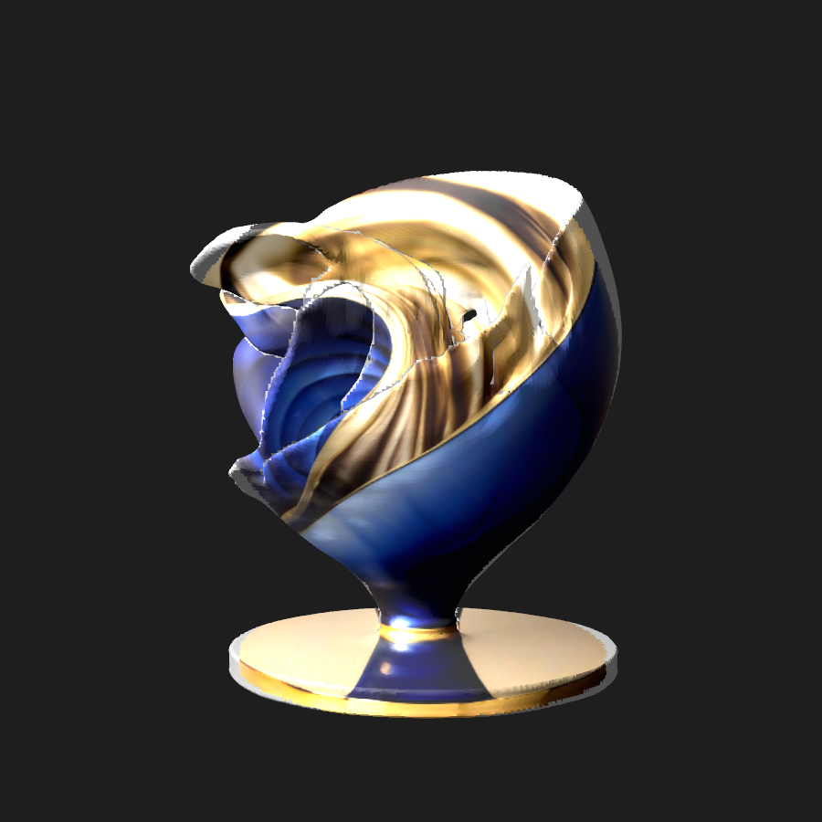
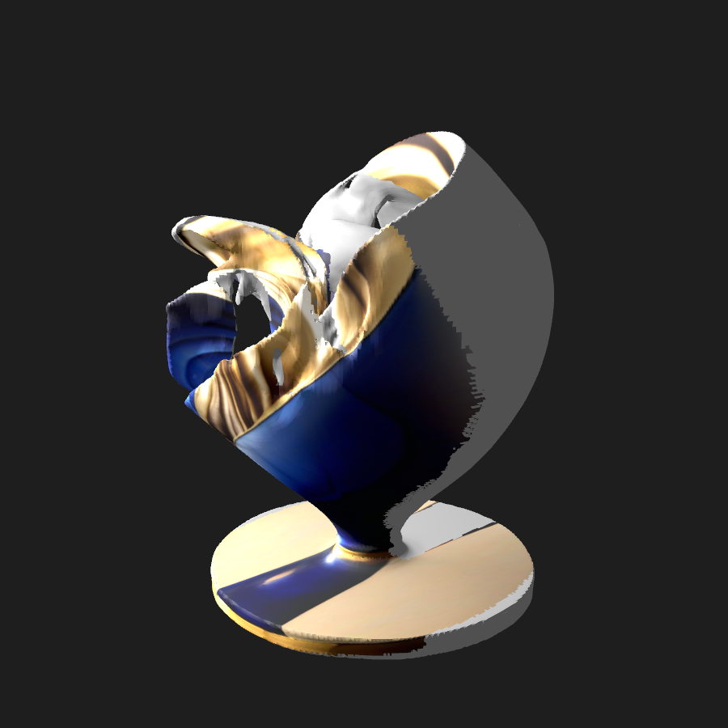
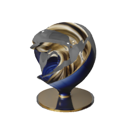

# 单视图参考色投影：原型与兼容性边界

本目录是独立 Swift/Apple 框架 CPU 原型，未接入正式 App/SDK，未操作手机，未调用 NN 或增加模型。实际输入是同一次神经生成的 strict 花瓶网格与已有 512 RGBA 参考图。输出有真实 GLB `COLOR_0` 和 USDZ 顶点色，不把参考图当作模型预览。

后续新增的 **小 UV + 内嵌 PNG 格式门禁已实际通过 Mac QuickLook 有色缩略图**，仅限合成三顶点，不是对大花瓶的纹理或 App 验收。见 [texture-condition.md](texture-condition.md) 与 `texture-verification.json`。下面原 vertex-color 两条件的失败结论仍保持。

再后的 **双材质大花瓶 CPU 候选已完成真实原生文件/显示验证**：25.42%面采原图、其余中性，三角世界坐标/绕序精确，GLB/sourceTriangleMap和原生USDZ均通过；QL与两角度确有蓝金和灰背。硬缝/白亮/投影和光照错配明显，完整外观/PBR未验收，未接App或真机。见 [dual-material-condition.md](dual-material-condition.md)、`dual-material-verification.json` 和下面实际PNG。

| 条件 | 颜色数据/文件 | 实际原生显示 | 范围 |
| --- | --- | --- | --- |
| 大vertex color连接材质 | 数据通过 | 两视图灰色 | 失败原物保留 |
| 小vertex color白基底 | 数据、SCN桥接RGB通过 | QL灰白 | QL失败保留 |
| 小UV/PNG | 文件/原生几何通过 | QL RGB通过 | 仅合成三角形 |
| 双材质原PNG/中性 | 逐原面几何、材质通过 | 小分区+大花瓶QL有色 | 仅文件能力，外观/产品未验收 |







实际只做了 **一次完整网格投色**：200370 vertices / 400772 triangles，54349 个顶点得到参考 RGB，146021 个保留中性灰。GLB POSITION/index buffer 字节、点数、三角形次序/绕序均保持；USDZ 经 Apple ModelIO 读回的 P3 顶点色最大误差为 0。原网格/PNG 未修改，strict 原物仍非 watertight。相机和主体范围对应是粗近似，未知背面不做还原，参考光照会烘进 RGB；不是多视图或 PBR 重建。

**显示兼容尚未通过，不能接入产品。** 首次完整产物的两张实际 SceneKit 视图仍为灰色：原生桥接把 `UsdPrimvarReader_float3 → diffuse` 连接材质的 diffuse 导入成数值 0。随后在一个 3 顶点 RGB 小资产上，文件内白色 diffuse 基底让 ModelIO → SceneKit 原生桥接显示 4754 个彩色像素，颜色数据也真实读回；renderer 没有重涂或覆盖材质。但是同一小 USDZ 的一次 QuickLook thumbnail 是真实模型三角形、仍为白灰（彩色像素 0），没有把文件图标当成功。正式 App 的 RealityKit `Entity(contentsOf:)` 没有验证。本轮因此没有盲目重跑第二份大网格。

三项证据须分别阅读：USDZ 顶点色数据 **通过**；小资产 SceneKit/ModelIO 桥接 RGB **通过**；小资产 QuickLook 颜色 **失败**。不能把前两项当作当前 App、QuickLook 或真机验收。

## 文件和产物

- `design.md`：投影/遮挡/色彩空间合同和明确限制。
- `protocol-before-run.json`：第一次完整运行的源码、二进制和两个原物 SHA；该次使用原先的 primvar 连接材质。
- `protocol-raster-preparation.json`：早期未运行的准备状态；其后红测试修复了薄后层被 0.5% 深度容差误涂的问题。
- `constant-white-condition.patch`：后续仅小资产采用的文件材质变更。当前源为这一白色基底条件，不是首次大资产条件。
- `verification.json`：分开的实际结果、SHA、原生导入路径、失败与覆盖率。大文件全部留在 ignored `.build`。
- `source-provenance.json`：仅复制了正式 SDK 的一份 USDZ 归档器，其余原型独立，没有复制模型仓或引入 MLX/推理依赖。

实际大产物位于 `Apple/.build/ReferenceColorProjection/VaseStrict01/`：`projected.glb`、`projected.usdz`、两张 `projected-{front,threequarter}.png`（均为灰色失败证据）及 `report.json`。小资产位于 `Apple/.build/ReferenceColorProjection/WhiteBaseTiny01/`，包含真实 RGB 原生截图与 `quicklook/quicklook.png`（白灰失败证据）。不要把这些大产物或构建目录加入 Git。

## 构建与测试

仓库根目录运行：

```sh
swift test --package-path docs/prototypes/2026-11-06-reference-color-projection \
  --scratch-path Apple/.build/ReferenceColorProjectionBuild
```

共21个测试通过。保留8项覆盖前后遮挡、薄近后层红→绿、去预乘/线性化、真实 PNG 上下/左右/非对称 alpha、GLB 几何字节、原生 P3 转换，以及真实小 USDZ 原生颜色读回和非灰渲染；新增13项覆盖整面遮挡/mask、分组映射/绕序篡改、硬上限和真实原生CPU解析。合成测试不算 AI 成功，无需模型权重。

有固定原物时，CLI 接收 `strict.glb reference.png 新输出目录`。它校验这里钉住的两个输入 SHA，不覆盖已有输出。当前白色基底未对大网格运行，不能把未来运行当作这里已经完成的证据。`--quicklook-smoke 小USDZ 新输出目录` 是一次有 20 秒期限的原生缩略图观测，要求实际 `.thumbnail`，拒绝把图标当模型图；本轮只对声明的合成 RGB 三角形执行一次。

双材质入口为 `--dual-material-smoke 新目录`（合成两三角形）和 `--dual-material-large 固定strict.glb 固定reference.png 新目录`。后者要求协议中两个真实原物的完整SHA；它们的大文件不在Git，新clone只能先跑自包含测试/小探针，完整重现大结果须提供匹配原物。当前没有做通用展开/atlas，没有修改renderer材质或用预览滤镜绕过文件兼容性；正式RealityKit/真机仍未验收。所有旧条件的大产物、两次准备错误和实际PNG失败证据均保持。
