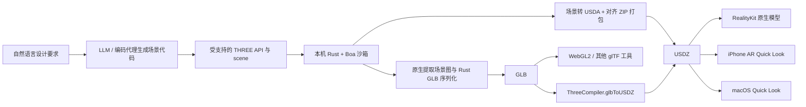

# Three-Live 在 iOS / macOS 生成 GLB 与 USDZ：源码研究与古建筑实验

发布计划补充（2026-11-05）：Apple 的 [2026-10-31 中国新闻稿](https://www.apple.com.cn/newsroom/2026/10/apple-intelligence-features-are-coming-to-users-in-china/) 已确认首批中国区 Apple 智能功能计划于 12 月随 iOS 27.3 正式版推出；当前仍为 Beta。该公告没有明确确认第三方 Foundation Models API 的中国区可用性。本项目已安排 [正式版跟踪和 12 月研发](tracking/ios-27.3-monitoring-plan.md)，并准备 [iPhone 离线 Xcode 工程方案](plans/2026-12-iphone-offline-xcode-design.md)；系统发布、模型资格和真机验收继续分别记录。

研究日期：2026-11-05。研究基准为官方 `google/three-live` 的 **v1.2.3**，固定提交 `c0ff24b628795286a175f1a71611673df5dbc05d`。已在 Mac 上完成古建筑 GLB / USDZ 生成、Khronos 与 Apple 严格校验，以及 RealityKit 原生导入和网格 / 材质回读。成品与运行指标见 [`../artifacts/validation.json`](../artifacts/validation.json)；iPhone 真机 AR 尚未执行。

## 1. 结论与适用范围

Three-Live 适合把 AI 编写的**程序化三维场景代码**转成可携带、可在 Apple 原生引擎中加载的模型。它本身不包含从一句提示词直接推理网格的扩散模型，也不要求下载大型生成模型权重。

完整路径为：



在本次实验中，AI 创作环节由当前编码会话完成；程序在 Mac 上生成可重复的古建筑参数和网格，然后交给**官方 Three-Live 原生编译器**输出 GLB / USDZ。没有使用 Blender 或通用 GLTFExporter 代替 Three-Live 建模与编译。宿主程序预计算网格，是为了使复杂曲面与重复构件适应其原生沙箱时间预算；最终仍以 `THREE.BufferGeometry`、材质、Mesh 和 `scene` 为输入，经官方运行时编译。这属于其支持的场景描述管线。

原生实测发现上游 USDZ 缺少 `MaterialBindingAPI` 元数据，原始古建筑输出有 17 个对应校验错误。已为 17 个 Mesh 补 schema、编码为 USDC 并重打包，最终 USDZ 通过 Apple 严格校验。实验同时保留未经修改的 Three-Live USDZ 与修复后的成品，详细见第 5.4 节。格式修复没有重新生成建筑网格。

本实验的建筑是原创中国传统宫殿风格的展示模型。屋顶、斗栱、柱网、台基等用于检验复杂度和可视表现；没有声称复原某一历史建筑，也不能据此推定传统营造尺寸、榫卯结构或文物考证正确。

项目公开托管于 Google GitHub 组织，采用 Apache 2.0；官方同时说明它不是受 Google 正式支持的产品，当前仍属 Developer Preview / Alpha。应把“生产文件”与“达到生产环境质量”分别评估。[官方发布说明及代码入口](https://opensource.googleblog.com/2026/11/introducing-three-live-ai-generated-3d-ar-webxr.html)、[固定版本 README](https://github.com/google/three-live/blob/c0ff24b628795286a175f1a71611673df5dbc05d/README.md)。

## 2. 版本与运行环境

| 项目 | 核实内容 |
| --- | --- |
| 官方仓库 | `https://github.com/google/three-live` |
| 本次固定发布 | `v1.2.3`，GitHub API 发布时刻为 `2026-11-04T23:11:23Z` |
| 固定提交 | `c0ff24b628795286a175f1a71611673df5dbc05d` |
| Mac 本机 | MacBook Pro，Apple M3 Max，48 GB 内存，macOS 27.2；由主实验检查本机环境 |
| 原生编译器 | 官方 `three-live-cli-macos-arm64` 发布二进制 |
| Apple 最低声明版本 | iOS 15、macOS 12、visionOS 1、tvOS 15 |
| Swift 工具版本 | Package.swift 声明 Swift tools 5.9 |
| Apple 分发方式 | Swift Package Manager + 校验和固定的预编译 XCFramework |
| 基本使用是否需要本机 Rust / Node | 使用官方 CLI 或预编译 Swift 包不需要自行构建 Rust / Node 工具链 |

版本来源：[v1.2.3 Release](https://github.com/google/three-live/releases/tag/v1.2.3)、[Release API](https://api.github.com/repos/google/three-live/releases/tags/v1.2.3)、[Package.swift](https://github.com/google/three-live/blob/c0ff24b628795286a175f1a71611673df5dbc05d/Package.swift)。

2026-11-03 的官方介绍仍以 v1.0.0 为例。当前执行以固定发布和源码为准，不照搬介绍文章中的旧包体积、CDN 地址或示例脚本类型。源码文档规定场景脚本类型为 `text/three`；当前 README 说明直接使用 GitHub 发布、SPM 和 Pages，公共 npm / Crates.io / Maven 发布仍列为后续计划。

## 3. 第一段：自然语言到受约束的场景代码

LLM 的产物是 JavaScript 场景描述：

```js
const material = new THREE.MeshStandardMaterial({
  name: 'vermillion', color: 0xa52724, roughness: 0.7, metalness: 0.0
});
const column = new THREE.Mesh(
  new THREE.CylinderGeometry(0.18, 0.21, 3.0, 12), material
);
column.name = 'front_column_01';
column.position.set(0, 1.5, 0);
scene.add(column);
```

`THREE` 和全局 `scene` 已由运行时提供。不要在输入脚本中导入完整版 Three.js、创建 WebGLRenderer、访问 DOM、调用网络模型加载器或自行建立渲染循环。场景生成必须发生在规定沙箱中。

古建筑的重复性很适合程序化表达：柱网、梁枋、斗栱、台阶、栏板、瓦垄和屋脊可共享参数；屋顶曲面可以由控制曲线或参数网格计算。生成网格前应明确坐标轴、米制单位、底面高度、对称轴、层级命名和细节预算。

本实验采用“宿主生成构件及曲面 → 按材质 / 部件合并 → 输出合法 scene.js”形式：

1. 保留可阅读、可修改的参数生成器作为创作来源。
2. 在宿主计算曲面、三角形索引和法线，减少 Boa 中逐顶点计算。
3. 使用少量 `THREE.BufferGeometry` 和明确命名的 Mesh。
4. 把颜色、粗糙度、金属度作为独立材质，不依赖外部贴图。
5. 控制最终脚本大小、顶点数和索引数；计数必须以输出文件回读为准。

这与“从照片重建网格”或“模型根据图像猜测背面”是不同技术路径。可重复生成是其优点；建筑真实感和工艺正确性取决于场景程序本身。

作者规则来源：[官方 authoring skill](https://github.com/google/three-live/blob/c0ff24b628795286a175f1a71611673df5dbc05d/skills/three-live-authoring/SKILL.md)、[LLM guide](https://github.com/google/three-live/blob/c0ff24b628795286a175f1a71611673df5dbc05d/docs/llm-guide.md)。

## 4. 第二段：浏览器沙箱与 Apple 原生沙箱

| 执行环境 | 代码运行位置 | 输出与后续展示 |
| --- | --- | --- |
| macOS CLI | Rust 中嵌入 Boa ECMAScript 引擎，运行内置的 Three-Live author engine | GLB / USDZ 文件 |
| iOS / macOS Swift SDK | Swift → C FFI → 同一 Rust / Boa 编译器 | Swift `Data`，随后写文件或交给原生显示 |
| Safari / 桌面浏览器 | 专用 Web Worker，或隔离 iframe + Worker | JS 打包 GLB / USDZ，WebGL2 展示，系统 AR 文件交接 |

原生不依赖 WKWebView 生成网格。项目使用“JIT compiler”描述能力，但研究中能直接核实的是：Boa 执行受支持的 JavaScript，随后生成标准模型字节；不应把这个称呼理解成任意 JS 会被编译为 Apple 原生机器码。

### 4.1 必须区分 250 ms、1000 ms 和 3000 ms

源码 `compiler/src/constants.rs` 的 release 配置明确给出：

| 限制 | 实际值与含义 |
| --- | --- |
| 原生不可信脚本执行 | **250 ms**；通过每 10,000 个 opcode 的时钟检查抢占终止 |
| 原生场景提取 | GLB 路径在脚本执行后还检查累计时间，仍受 250 ms 总预算约束 |
| 原生 USDZ 打包 / GLB 转 USDZ | **1000 ms**；与不可信脚本执行分开计时 / 检查，但 USDZ 路径最终检查累计用时 |
| Web Worker 外层 watchdog | **3000 ms**；宿主级完整请求超时 |
| Rust debug 构建 | 脚本 2000 ms，打包 20000 ms；不能据此推断 release 会通过 |

官方 authoring 文档笼统写“3 秒执行超时”；对 Apple release 编译器而言，应以源码中的 **250 ms 不可信脚本预算**为设计依据。复杂场景即使低于顶点上限，也可能先触发时间限制。增加宿主计算、减少网格数量和避免运行时重复算法，比修改上游安全限额更适合本实验。

来源：[执行限额常量](https://github.com/google/three-live/blob/c0ff24b628795286a175f1a71611673df5dbc05d/compiler/src/constants.rs)、[Boa 执行、提取、USDZ 路径](https://github.com/google/three-live/blob/c0ff24b628795286a175f1a71611673df5dbc05d/compiler/src/engine.rs)。

### 4.2 几何与内存预算

| 项目 | v1.2.3 代码中的限制 |
| --- | --- |
| 每场景 Mesh | 1000 |
| 每场景顶点 | 100,000 |
| 每场景索引 | 300,000，全部为三角形时即 100,000 个三角形 |
| 纹理数量 | 16 |
| 纹理尺寸 | 最大 2048 × 2048，由 JS author 层验证 |
| 脚本 UTF-8 大小 | 1 MiB |
| 主要 ArrayBuffer / 原生输入上限 | 16 MiB |
| Boa 单循环迭代限制 | 250,000 |
| Boa 递归限制 | 64 |
| 场景节点提取 | 最大 4000，即 Mesh 上限的 4 倍 |

16 MiB 常量名称使用“heap”，但 `engine.rs` 注释明确说明 Boa 的 HostHooks 只覆盖 ArrayBuffer，并不是所有 JS 分配的完整堆总量上限。不能把它当作整个进程的最大内存；实际内存需要独立测量。

顶点上限也不等于“10 万独立构件”：盒子的硬边、UV 接缝和分材质会复制顶点。若要导出数千个小构件，应在宿主中合并几何，或者拆为多个独立资产。本实验目标是一个整体可携带的建筑模型，故优先合并。

## 5. 第三段：几何、材质与格式转换的真实支持范围

### 5.1 适合本实验的受支持 API

核心实现直接提供：

```js
const geometry = new THREE.BufferGeometry();
geometry.setAttribute('position', new THREE.Float32BufferAttribute(positions, 3));
geometry.setAttribute('normal', new THREE.Float32BufferAttribute(normals, 3));
geometry.setIndex(indices); // number[]，或合法 Uint16Array / Uint32Array
const mesh = new THREE.Mesh(geometry, material);
mesh.name = 'roof_upper_glazed_tiles';
scene.add(mesh);
```

`BufferAttribute`、`Float32BufferAttribute`、`Uint16BufferAttribute`、`Uint32BufferAttribute`、`computeVertexNormals()` 都有实际实现。法线可以运行时计算，但对复杂网格应预计算，以节省原生脚本预算。`Mesh` 的位置、旋转和缩放有实现；USDZ 路径会将变换烘焙进顶点，并对法线应用相应逆转置变换。

不要假定完整 Three.js 的所有 BufferGeometry 便捷函数均存在。例如这里的 BufferGeometry 没有通用 `applyMatrix4()` 或 `BufferGeometryUtils.mergeGeometries()`。复杂屋顶应自己计算局部坐标和索引，或使用实际支持的 Mesh 变换。

来源：[three-author.ts 的具体类实现](https://github.com/google/three-live/blob/c0ff24b628795286a175f1a71611673df5dbc05d/three-live/src/three-author.ts)。

### 5.2 多材质与材质命名

v1.2.3 的 `new THREE.Mesh(geometry, materialArray)` 实际只取数组第一个材质。不能照搬完整 Three.js 的“geometry groups + 多材质 Mesh”方式，期待全部颜色保留。

可行形式是每个材质 / 部件分别创建一个 Mesh。每个材质赋唯一稳定名称，避免 USDZ writer 按同名材质去重时产生意外复用。古建筑可使用朱红柱、深色木梁、青绿彩画、琉璃黄瓦、石台基等少量实体 PBR 材质。

### 5.3 GLB 与 USDZ 的输出并不等价

| 特性 | GLB 路径 | USDZ 路径与实验处理 |
| --- | --- | --- |
| 基本网格 / 索引 / 法线 | Rust 提取并写入 glTF 2.0 | 转为 USDA Mesh，写入对齐 ZIP |
| 节点层级 / TRS | 代码保留节点与局部变换 | 静态几何通常被烘焙到世界坐标并展开 |
| PBR 基础材质 | glTF PBR 因子及部分扩展 | `UsdPreviewSurface` 标量与颜色；使用其交集 |
| GPU instancing | `EXT_mesh_gpu_instancing` | 当前源码展开为多个 Mesh，不能据文档直接推定 PointInstancer |
| 材质贴图 | GLB 有纹理路径与数据处理 | 当前 USDZ packager 仅写 `model.usda`，未打包图像；本实验不用贴图 |
| 双面显示 | GLB 会写材质 `doubleSided`，该 author Material 默认开启 | USDA writer 未写 Mesh `doubleSided`；不能依赖 GLB 的双面默认值掩盖反向面 |
| JavaScript 交互 | 需宿主运行时理解声明及绑定 | 文件交给系统 Quick Look 后，不能假定任意 JS、插件或事件处理继续运行 |

特别注意：AGENTS / authoring 文本提到 USDZ PointInstancer / VariantSets，但本次固定提交的 `extractMeshesFromScene()` 和 USDA generator 显示的实际路径是**展开实例并写 Mesh**。实现优先于文案。

InstancedMesh 构造器允许最多 10,000 个实例，但直接场景转 USDZ 的实现使用 `Math.min(1000, count)`：一个 InstancedMesh 超过 1000 时，后续实例会被截去。GLB 路径没有同样的这处截断。为了两种格式内容一致，本实验避免依赖此行为；若以后使用实例化，必须给每组设置明确上限并检查转换结果。

来源：[GLB Rust writer](https://github.com/google/three-live/blob/c0ff24b628795286a175f1a71611673df5dbc05d/compiler/src/glb.rs)、[场景提取与 USDA / ZIP writer](https://github.com/google/three-live/blob/c0ff24b628795286a175f1a71611673df5dbc05d/three-live/src/three-convert.ts)、[USDZ Rust 加速器与对齐打包](https://github.com/google/three-live/blob/c0ff24b628795286a175f1a71611673df5dbc05d/compiler/src/usdz.rs)。

### 5.4 已复现的 Apple USD 校验缺陷与修复关卡

本次在官方 v1.2.3 原生 CLI 上用一个最小立方体场景生成 USDZ。Apple `usdchecker --arkit --strict` 报告：

```text
MissingMaterialBindingAPI
</Root/Meshes/native_compiler_smoke>
```

上游 USDA writer 写出了 `rel material:binding`，但没有为使用它的 Mesh 应用 `MaterialBindingAPI` schema。这是可复现的输出元数据缺陷；“CLI 编译成功”和“Apple 严格校验通过”需要分开报告。

修复路径为：保留原始 USDZ → 打开其 USD layer → 为有材质绑定的 Mesh 补充 `MaterialBindingAPI` 和 `subdivisionScheme = "none"` → 用 Apple USD Tools 转为 USDC / 重新打包 → 再执行严格校验 → 最后进行 Apple 原生加载。

该路径已在完整古建筑上执行：原始文件报出 17 个 `MissingMaterialBindingAPI`，修复 17 个 Mesh 后，`usdchecker --arkit --strict artifacts/palace.usdz` 以 exit 0 返回 `Success!`。最终模型也已通过 macOS RealityKit `Entity(contentsOf:)` 实际导入和网格 / 材质回读。完整输出见 [`../artifacts/validation.json`](../artifacts/validation.json) 和 [`../artifacts/realitykit-validation.json`](../artifacts/realitykit-validation.json)。

模型结构、顶点与材质因子在修复前后仍须回读对照。Apple 重打包属于输出兼容性步骤，不应把修复后的文件描述成“官方 Three-Live 无后处理原样输出”。

## 6. 第四段：macOS 上从脚本到两种模型文件

使用官方 Apple Silicon 二进制，不需要 GPU 推理：

```sh
# 在当前工作区根目录；tools/three-live-cli 为已下载的固定版本二进制。
tools/three-live-cli validate scenes/palace.js
tools/three-live-cli convert scenes/palace.js -o artifacts/palace.glb
tools/three-live-cli convert scenes/palace.js -o artifacts/palace-raw.usdz
tools/three-live-cli info artifacts/palace.glb
tools/three-live-cli info artifacts/palace-raw.usdz
```

CLI 的 `convert` 根据 `-o` 扩展名识别格式，也可以显式指定 `--format glb` 或 `--format usdz`。原生还支持：

```sh
tools/three-live-cli convert artifacts/palace.glb \
  -o artifacts/palace-from-glb-raw.usdz
```

直接 scene → GLB 和 scene → USDZ 是两次独立执行；GLB → USDZ 是第三条可选路径。实验应至少保存其中两种主要产物，若进行跨格式一致性检查，应记录走的是哪条路径。

`validate` 会执行脚本并列出 Mesh、顶点、索引、材质、灯光等场景统计。`info` 主要检查 / 展示容器头、chunk 或 ZIP 对齐，并非完整 glTF / USD 语义验证。成功退出不等于模型已经在 RealityKit 中可正确展示。

完整本地实验的入口为：

```sh
python3 scripts/run_pipeline.py
python3 scripts/serve.py
```

第一条命令依次执行：宿主生成几何 → 官方 CLI validate → 原生 JS→GLB → 原生 JS→USDZ → 原生 GLB→USDZ → 原始 USDZ Apple 检查 → MaterialBindingAPI 与禁止默认细分的元数据修复 → `usdcat` 编码 USDC → `usdzip --arkitAsset` 打包 → 最终 `usdchecker --arkit --strict` → Khronos glTF Validator → Swift RealityKit 实际读取及跨格式计数 / 包围盒对比。原始与最终 USDZ 分别为 `palace-raw.usdz` 和 `palace.usdz`。运行结果写入 `artifacts/validation.json`，Khronos 详细结果写入 `artifacts/glb-validation.json`。

第二条命令启动本地网页 `http://localhost:8765/`，使用 `tools/web` 中固定版本官方 bundle 加载模型。iPhone 在同一局域网使用 Mac 的局域网 IP 访问该端口；这只是访问入口，手机验收仍要实际执行。Apple 原生 RealityKit 读取检查由同一管线调用单独的 Swift 可执行文件，并记录到 `artifacts/realitykit-validation.json`；它不等于屏幕渲染或真机 AR 证据。

官方二进制：`https://github.com/google/three-live/releases/download/v1.2.3/three-live-cli-macos-arm64`。命令定义：[compiler/src/main.rs](https://github.com/google/three-live/blob/c0ff24b628795286a175f1a71611673df5dbc05d/compiler/src/main.rs)。

## 7. 第五段：iOS / macOS Swift 原生集成

### 7.1 固定 SPM 版本

```swift
// Package.swift 中：
.package(url: "https://github.com/google/three-live.git", exact: "1.2.3")

// 对应 target 的 dependencies 中：
.product(name: "ThreeLiveCompiler", package: "three-live")
```

上游 manifest 优先使用本地生成的 XCFramework；不存在时下载发布归档，并核验 SHA-256。v1.2.3 manifest 中校验和为 `382fd2fbaa3909fe87e90e9f4ceabaec25fcd22faeb09f91e3490e9021280c59`。编译器二进制与 Swift API 需要固定为同一版本。

### 7.2 端上编译并原子保存

**iOS 产品化边界：**下面代码说明公开 API 的调用顺序；v1.2.3 的 `compileUSDZ` / `glbToUSDZ` 共享前述 exporter 缺陷。iPhone 不能调用本实验 Mac 上的 `usdcat` / `usdzip` 命令，所以要实现完整端上生产，应先在上游 `three-convert.ts` 的 USDA writer 补齐材质 schema 和 `subdivisionScheme = "none"`，再重建 author engine 与 XCFramework，或实现经过校验的端上 USDZ 后处理。另一条已在本轮完成的路径是在 Mac 生产修正后的 `palace.usdz`，交给 iPhone 查看。不可把这两条路径混称为“手机端从零生成已验收”。


以下代码匹配所检查版本的公开 API，属于集成示例，是否在具体 Xcode 目标中构建成功仍需单独验证。

```swift
import Foundation
import ThreeLiveCompiler

func exportArchitecture(script: String, directory: URL) async throws {
    try FileManager.default.createDirectory(
        at: directory, withIntermediateDirectories: true
    )
    let glb = try await ThreeCompiler.compileGLB(script)
    let usdz = try await ThreeCompiler.compileUSDZ(script)
    try glb.write(
        to: directory.appendingPathComponent("palace.glb"),
        options: .atomic
    )
    try usdz.write(
        to: directory.appendingPathComponent("palace-raw.usdz"),
        options: .atomic
    )
}
```

其他确切公开入口为 `ThreeCompiler.compile(_:)`、`compileSync(_:)`、`compileGLBSync(_:)`、`compileUSDZSync(_:)`、`glbToUSDZ(_:)`、`glbToUSDZSync(_:)`。

Swift 包在一个固定的 **8 MiB 栈线程**上串行运行阻塞编译工作，复用线程局部 Boa VM；它没有把重 CPU 编译直接放到主线程或 Swift cooperative executor。应使用 async API，让 UI 可以展示状态。Swift Task 取消不会立即中止已进入的 native 调用；原生 VM 自己的超时仍然生效。

来源：[ThreeCompiler.swift](https://github.com/google/three-live/blob/c0ff24b628795286a175f1a71611673df5dbc05d/mobile/ios/Sources/ThreeLiveCompiler/ThreeCompiler.swift)。

### 7.3 RealityKit 真正加载的路径

```swift
import RealityKit
import ThreeLiveCompiler

@MainActor
func loadArchitecture(script: String) async throws -> Entity {
    let usdz = try await ThreeCompiler.compileUSDZ(script)
    return try await RealityKitHelper.loadEntity(fromUSDZ: usdz)
}
```

也可使用 `RealityKitHelper.loadEntity(from: script)`；它内部先编译 USDZ。`RealityKitHelper.loadEntity(fromGLB: data)` 内部先将 GLB 转为 USDZ，再加载。它不是 RealityKit 原生直接解析 GLB 的证明。

辅助类会将 USDZ 写到唯一临时路径，异步加载后清理文件。在 iOS 18 / macOS 15 及以上使用 async Entity initializer，较旧系统使用 Combine 的异步 loader。它还会移除导入层级中的 `AnchoringComponent`，避免模型置于宿主自建 AnchorEntity 后，因为未匹配到 ARKit 平面而整体 inactive。

若模型采用 1 单位 = 1 米，场景视图需要设置合理相机、地面和缩放；桌面上的微缩展示与 AR 中的实际尺寸是不同验收项。不要通过模型显示在屏幕上就推定世界尺度正确。

来源：[RealityKitHelper.swift](https://github.com/google/three-live/blob/c0ff24b628795286a175f1a71611673df5dbc05d/mobile/ios/Sources/ThreeLiveCompiler/RealityKitHelper.swift)。

### 7.4 iPhone AR Quick Look 与 macOS Quick Look

在支持 AR 的 iPhone 上，可从已挂到可见窗口的 UIViewController 调用：

```swift
import UIKit
import ThreeLiveCompiler

@MainActor
func previewArchitecture(from controller: UIViewController, usdz: Data) async throws {
    try await QuickLookHelper.presentAR(from: controller, usdzData: usdz)
}
```

`QuickLookHelper` 条件编译要求 UIKit，因此不能把同一 helper 直接当作 macOS AppKit API。macOS 可用 Finder Quick Look / `qlmanage` 查看 USDZ，或通过 RealityKit 集成到原生视图；相机 AR 放置应在 iPhone 真机验证。

iPhone 宿主应提供相机用途说明；`QuickLookHelper.isARPlacementSupported` 会在 simulator 返回 false，在 iOS 真机查询 ARWorldTrackingConfiguration 支持状态。展示一个静态 USDZ 不会自动带上全部 XR-Live 插件行为。

来源：[QuickLookHelper.swift](https://github.com/google/three-live/blob/c0ff24b628795286a175f1a71611673df5dbc05d/mobile/ios/Sources/ThreeLiveCompiler/QuickLookHelper.swift)。

## 8. 浏览器作为 iPhone 入口时的区别

无需安装原生 App 的入口可以是 HTTPS 网页：

```html
<script type="module" src="/vendor/three-live.min.js"></script>
<three-live allow-client-scripts camera-controls ar
            style="display:block;width:100%;height:70vh">
  <script type="text/three">
    // 与原生编译器兼容的 THREE / scene 场景描述
  </script>
</three-live>
```

浏览器版本使用 Worker 中的 JS author engine，不能把它的成功视为 Rust / Boa 路径已成功。iOS Safari 的空间体验需要区分网页 WebGL 展示与 USDZ 交给 Quick Look 后的相机 AR；不能把网页里拖拽旋转模型称作已经验证了 AR 世界追踪。

如果只查看已生成文件，`<three-live src="...glb">` 不需要运行场景脚本。资产可从本地 Mac 服务传给手机；只有实际在手机打开、进入模型预览 / AR、确认尺度和遮挡之后，才能报告 iPhone 验收。

来源：[Web component 参考](https://github.com/google/three-live/blob/c0ff24b628795286a175f1a71611673df5dbc05d/docs/three-live.md)、[官方 playground](https://google.github.io/three-live/)。

## 9. 中国古建筑实验：设计、验证与证据

已生成模型名为**琉金重檐殿 / Golden Eaves Hall**，是传统宫殿风格的桌面微缩模型，包含：

- 2 层四面曲线庑殿式屋顶，每层 84 条瓦垄，以及上翘檐角、屋脊和抽象脊兽。
- 20 根朱红柱、梁枋与简化斗栱，12 扇格栅门叶和 4 盏灯笼。
- 3 层石台基、11 级正面台阶、栏杆与铺地。
- 17 个按材质合并的网格，覆盖木、彩画、琉璃瓦、石材和金饰等实体 PBR 颜色。

输入为 [`../scenes/palace.js`](../scenes/palace.js)，参数和源模型检查见 [`../scenes/palace-source.json`](../scenes/palace-source.json)。没有使用输入模型、下载几何、外部贴图、生成模型权重或云端推理。

主要成品路径为 [`../artifacts/palace.glb`](../artifacts/palace.glb)、[`../artifacts/palace.usdz`](../artifacts/palace.usdz)。原样 Three-Live 输出保留为 [`../artifacts/palace-raw.usdz`](../artifacts/palace-raw.usdz) 和 [`../artifacts/palace-from-glb-raw.usdz`](../artifacts/palace-from-glb-raw.usdz)。

### 9.1 实际文件与检查结果

| 指标 | 实测结果 |
| --- | --- |
| 输入 JavaScript | 1,037,397 字节，距 1 MiB 上限仅余 11,179 字节 |
| GLB | 906,532 字节；17 Mesh / 17 材质 / 17 节点 |
| GLB 几何 | 26,150 顶点，66,120 索引，22,040 三角形 |
| 原始 scene → USDZ | 1,650,759 字节；Apple 严格校验失败，17 个缺失 schema 错误 |
| 原始 GLB → USDZ | 1,650,759 字节；与 scene → USDZ 的 SHA-256 完全一致 |
| Apple 兼容最终 USDZ | 636,850 字节；补 schema 并转 USDC 后重打包，未修改导出后的顶点或索引值 |
| Khronos glTF Validator | `2.0.0-dev.3.10`；0 error、0 warning、0 info、0 hint |
| Apple `usdchecker --arkit --strict` | 最终文件通过，exit 0 |
| 宿主几何检查 | 0 退化三角形，面朝向与外法线一致，最大法线长度误差约 `7.27 × 10⁻⁷` |
| 实际世界包围盒 | X `[-0.504, 0.504]` m；Y `[0, 0.42216]` m；Z `[-0.38496, 0.4344]` m |
| 展示尺寸 | 约 **1.008 × 0.42216 × 0.81936 米**，顺序为宽 × 高 × 深 |

文件大小与哈希来自 [`../artifacts/validation.json`](../artifacts/validation.json)；GLB 包围盒使用节点 TRS 后的米制坐标，详见 [`../artifacts/glb-validation.json`](../artifacts/glb-validation.json)。不应把未缩放的 accessor 坐标当作米制模型尺寸。源参数中的 `bounds_meters` 也由最终量化网格计算，并与文件回读尺寸相符。

### 9.2 实际耗时及其含义

| 操作 | 单次实测墙钟时间 |
| --- | --- |
| Python 宿主几何生成 | 210.21 ms |
| 官方 CLI scene validate | 200.93 ms |
| 官方 CLI scene → GLB | 200.54 ms |
| 官方 CLI scene → 原始 USDZ | 351.96 ms |
| 官方 CLI GLB → 原始 USDZ | 172.89 ms |
| Apple USDC 编码 | 44.37 ms |
| Apple USDZ 重打包 | 23.69 ms |
| 最终 Apple 严格校验 | 78.16 ms |
| Khronos GLB 校验 | 100.44 ms |
| RealityKit 导入及网格回读 | 约 238.38 ms |

CLI 时间由外层 `subprocess.run` 前后测量，**包含启动新进程、初始化 VM、读写文件和退出**；它不是热 VM 中隔离测得的纯编译时延，也不是 benchmark 分位数。单次 scene → USDZ 总耗时超过 250 ms，并不说明放宽了不可信脚本预算：脚本执行与可信输出打包属于不同的预算阶段。实验没有更改官方限额。

### 9.3 macOS RealityKit 原生回读

[`../artifacts/realitykit-validation.json`](../artifacts/realitykit-validation.json) 记录了 `Entity(contentsOf:)` 从最终 USDZ 实际导入后的结果：

- 19 个 Entity，其中 17 个具有 ModelComponent。
- 每个模型部件均具有 `PhysicallyBasedMaterial`，合计 17 个材质绑定。
- 25,964 个导入后顶点、22,040 个三角形。
- 0 个非有限变换 / 顶点 / 法线 / 索引异常，包围盒有效。
- 原生米制包围盒与 GLB 回读在浮点误差内一致。

RealityKit 比 GLB 少 186 个顶点；差异集中于屋顶表面 Mesh，三角形数、17 个模型部件和尺寸均一致。**较可能是导入器合并或整理等价顶点，但本实验未独立证实其内部机制**；因此不能把“顶点数减少”直接解释成已证明的去重算法，也不能仅凭总数推断网格被减面。

这条自动检查证明原生资产导入与网格 / 材质回读成功；屏幕渲染和 iPhone AR 世界追踪另外记录，不能仅从这份 JSON 推定。


### 9.4 原生显示额外暴露的 USD 细分声明问题

Mac Preview 中实际打开后，最初的 USDZ 屋顶出现三角形色斑，尽管文件严格校验和模型回读均通过。源码导出三角拓扑及顶点法线，却没有声明 `subdivisionScheme`。USD 默认使用 `catmullClark`；Apple 明确要求普通多边形资产用 `subdivisionScheme = "none"` 禁用默认细分。

因此最终后处理在每个 Mesh 上补充 `uniform token subdivisionScheme = "none"`，并保留 `MaterialBindingAPI` 声明。它不改变输入顶点、索引或 PBR 数值，而是明确这些网格应该以作者提供的三角面和法线显示。此类视觉问题不能由格式合规检查取代。依据：[Apple 创建 USD 指南](https://developer.apple.com/documentation/usd/creating-usd-files-for-apple-devices)、[OpenUSD Mesh 规范](https://openusd.org/dev/api/class_usd_geom_mesh.html)。

源几何还去除了 312 个完全重复三角面，消除相邻栏杆拐角和屋面接缝的重面；最终 GLB、USDZ 与 RealityKit 中均为 22,040 个三角形。这个清理发生在 Three-Live 编译之前，两种格式共用相同几何。

### 9.5 各层证据与剩余边界

| 层级 | 应检查的内容 | 不足以替代它的证据 |
| --- | --- | --- |
| 输入可重现 | 参数生成器、固定随机种子（如使用）、scene.js、工具版本与哈希 | 只有自然语言提示词 |
| 原生执行 | 官方 release CLI 实际执行，保留退出状态与错误 | 浏览器预览成功 |
| GLB 结构 | glTF2 header/chunk，accessor / bufferView 边界，有限数值，索引范围，场景计数 | 文件扩展名正确 |
| USDZ 容器 | ZIP 无压缩、CRC、64 字节 payload 对齐、USD root layer 可解析 | ZIP 能解压 |
| 跨格式内容 | 两个文件的 Mesh / 顶点 / 面计数、包围盒、材质及可视对照 | 两条命令都成功退出 |
| Mac 原生加载 | Quick Look 或 RealityKit 真实加载，截图及视角检查 | 仅 CLI `info` |
| iPhone 原生加载 | 手机打开 USDZ 并可操作；AR 放置另记 | Mac 截图或 simulator |
| 质量 | 屋顶曲面、檐角、构件相交、栏杆 / 斗栱细节等视觉检查 | 顶点数量很高 |

对于复杂场景，官方介绍的“通常 2–5 ms”不是本实验性能保证。当前已完成原生生成、格式严格校验和 macOS RealityKit 导入；Mac Preview 已打开最终 USDZ，修正默认细分后屋顶色斑消失；原生截图见 [`../artifacts/macos-preview.png`](../artifacts/macos-preview.png)，GLB 与 USDZ 另经相同相机的 Blender 对照渲染，17 个材质网格和 22,040 三角形一致。iPhone 安装与手机 AR 尚未执行。本文没有把完整 Swift App 构建、App Store 交付或历史建筑准确性当作已完成项。

## 10. 对后续产品化的判断

若目标是“在 Mac 上可重复创建中等复杂、风格明确的古建筑资产，并给 iPhone 查看”，这条程序化管线很合适：没有重型推理依赖，参数可修改，标准文件可交给原生引擎。

若目标升级到照片级古建筑、精确测绘或高密度斗栱榫卯，应另外安排可靠参考、尺寸约束、纹理制作、LOD / 分块和实际手机性能验证。Three-Live 当前的脚本时限与输出功能交集，决定它更适合紧凑的程序化资产，而不是在一个沙箱请求中生成无限细节。

本实验保留官方安全预算，不通过修改引擎上限使结果“勉强通过”。若最终大模型未通过预算，应降低复杂度、合并构件、预计算网格或分为多个模型，并在验证记录里保留失败事实和最后选择。

## 11. 主要一手来源

所有实现判断固定到同一提交，避免把之后主分支的变化混入实验：

1. 官方发布介绍：<https://opensource.googleblog.com/2026/11/introducing-three-live-ai-generated-3d-ar-webxr.html>。若直接页面限流，官方年度归档亦有原文：<https://opensource.googleblog.com/2026/>。
2. 固定 Release：<https://github.com/google/three-live/releases/tag/v1.2.3>。
3. 项目说明：<https://github.com/google/three-live/blob/c0ff24b628795286a175f1a71611673df5dbc05d/README.md>。
4. Apple 包配置：<https://github.com/google/three-live/blob/c0ff24b628795286a175f1a71611673df5dbc05d/Package.swift>。
5. 官方编写技能：<https://github.com/google/three-live/blob/c0ff24b628795286a175f1a71611673df5dbc05d/skills/three-live-authoring/SKILL.md>。
6. LLM guide：<https://github.com/google/three-live/blob/c0ff24b628795286a175f1a71611673df5dbc05d/docs/llm-guide.md>。
7. 原生预算：<https://github.com/google/three-live/blob/c0ff24b628795286a175f1a71611673df5dbc05d/compiler/src/constants.rs>。
8. Boa 引擎与场景提取：<https://github.com/google/three-live/blob/c0ff24b628795286a175f1a71611673df5dbc05d/compiler/src/engine.rs>。
9. Three API 子集：<https://github.com/google/three-live/blob/c0ff24b628795286a175f1a71611673df5dbc05d/three-live/src/three-author.ts>。
10. 格式转换实现：<https://github.com/google/three-live/blob/c0ff24b628795286a175f1a71611673df5dbc05d/three-live/src/three-convert.ts>。
11. 原生 GLB writer：<https://github.com/google/three-live/blob/c0ff24b628795286a175f1a71611673df5dbc05d/compiler/src/glb.rs>。
12. 原生 USDZ 加速器：<https://github.com/google/three-live/blob/c0ff24b628795286a175f1a71611673df5dbc05d/compiler/src/usdz.rs>。
13. CLI 定义：<https://github.com/google/three-live/blob/c0ff24b628795286a175f1a71611673df5dbc05d/compiler/src/main.rs>。
14. Swift 编译入口：<https://github.com/google/three-live/blob/c0ff24b628795286a175f1a71611673df5dbc05d/mobile/ios/Sources/ThreeLiveCompiler/ThreeCompiler.swift>。
15. RealityKit helper：<https://github.com/google/three-live/blob/c0ff24b628795286a175f1a71611673df5dbc05d/mobile/ios/Sources/ThreeLiveCompiler/RealityKitHelper.swift>。
16. Quick Look helper：<https://github.com/google/three-live/blob/c0ff24b628795286a175f1a71611673df5dbc05d/mobile/ios/Sources/ThreeLiveCompiler/QuickLookHelper.swift>。
